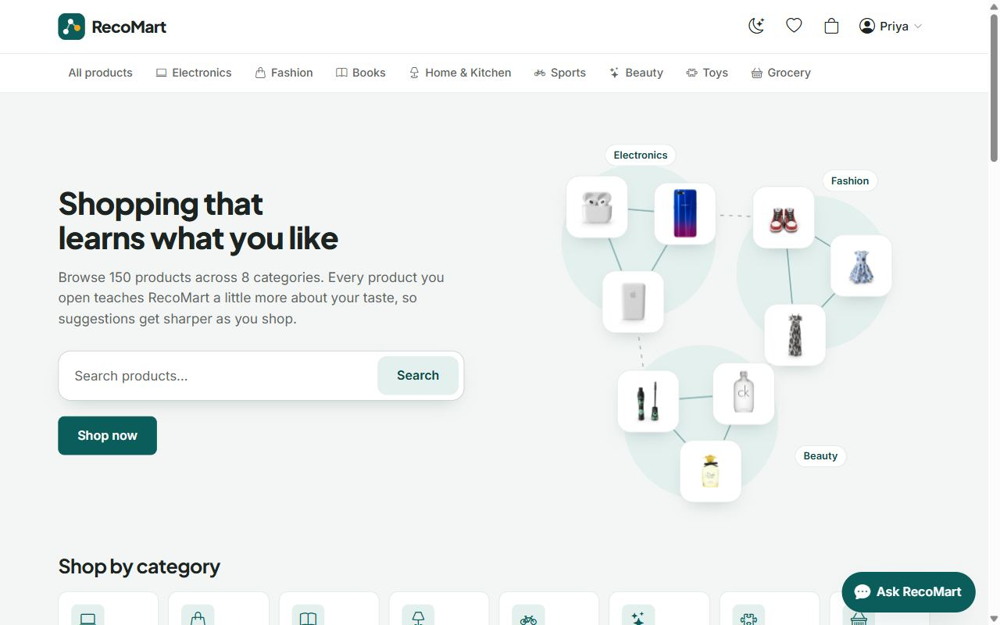
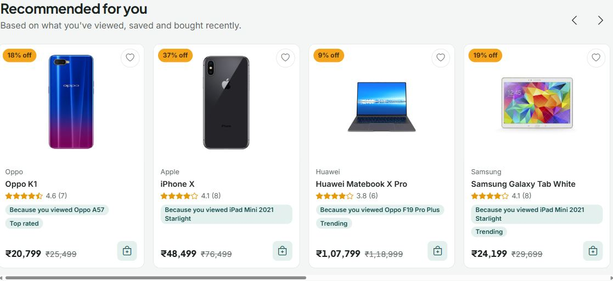
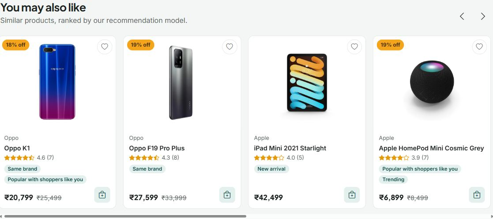
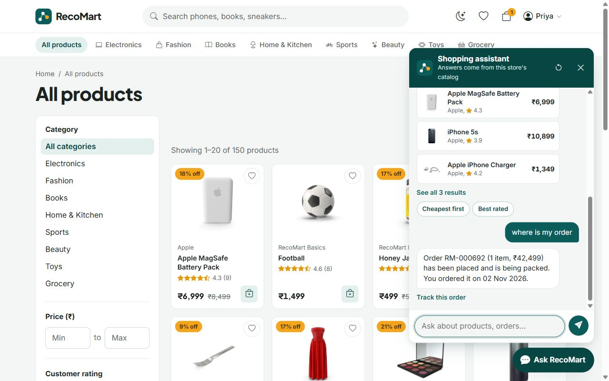
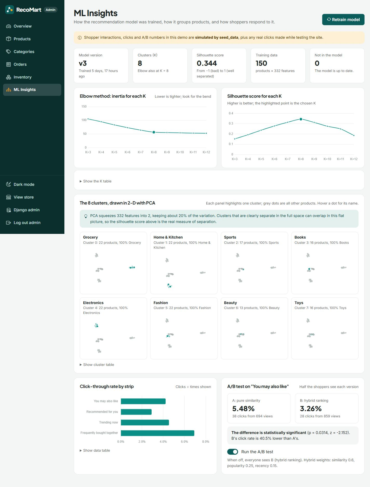

# RecoMart

**An online store whose recommendations learn what you like.** A Django e-commerce site with a built-in
machine-learning recommendation engine (TF-IDF + K-Means + cosine similarity), an offline shopping-assistant
chatbot, and an admin dashboard with ML insights and an A/B test.

*B.Tech CSE, Semester 5: Full Stack Development Lab project (team of 4).*



| Recommended for you | You may also like |
|---|---|
|  |  |

| Shopping assistant | Admin: ML Insights |
|---|---|
|  |  |

More screenshots are in [`docs/screenshots/`](docs/screenshots/): product page, cart, dark mode, mobile and the dashboard.

---

## Features

**For shoppers**
- **Browsing:** 150 products in 8 categories, with category pages and product pages (gallery, reviews, stock).
- **Live search** as you type, and **filters** (category, price, rating, sort) that update without reloading.
- **Cart:** works for guests too, and moves into your account when you log in.
- **Checkout** with a **simulated** payment (UPI, card or cash on delivery). No real money moves.
- **Orders:** order history, and a tracking page that goes Placed → Shipped → Delivered.
- **Wishlist** (heart button) and **reviews** with star ratings.
- **Recommendations:**
  - *You may also like*, *Recommended for you*, *Frequently bought together* and *Recently viewed*.
  - Every recommendation shows a **"Why this?"** reason, such as *Same brand* or *Because you viewed X*.
- **Shopping assistant chatbot:**
  - Ask "phones under 20k", "something like Atomic Habits", "where is my order" and more.
  - Works offline, with no AI service.
- **Look and feel:** dark/light mode, a responsive layout (phone, tablet, laptop), and accessibility built in (labels, focus states, screen-reader text).

**For the admin** (`/dashboard/`)
- **KPIs:** revenue, orders, average order value, buyers and low stock, with charts.
- **Managing the store:** add, edit and delete products (with images) and categories, update order status, and restock from the inventory page.
- **ML Insights:**
  - how K was chosen (elbow and silhouette)
  - cluster maps
  - click-through rates
  - the **A/B test** (similarity vs hybrid ranking) with a significance test
  - a **Retrain model** button

> **About the data:** the product catalog comes from the free [DummyJSON](https://dummyjson.com) test API (books and toys are our own). Users, orders, reviews, clicks and A/B numbers are **simulated by `seed_data`** so the recommender and charts have something to learn from.

---

## Tech stack

| Layer | Tools |
|---|---|
| Backend | Python 3.12, Django 5.2 LTS, Django ORM, SQLite (PostgreSQL-ready) |
| Frontend | Django Templates (inheritance from `base.html`), Bootstrap 5.3, Bootstrap Icons, vanilla JavaScript `fetch()` |
| ML | scikit-learn (TF-IDF, K-Means, PCA, silhouette score), NumPy, Pandas, Joblib |
| Charts | Chart.js |
| Config | `python-dotenv` (`.env` for secrets) |

Bootstrap, Bootstrap Icons, Chart.js and the fonts are **saved inside the project** (`static/vendor/`) instead of loaded from a CDN, so the demo works with no internet.

---

## Setup on Windows (PowerShell)

You need **Python 3.12** and **Git**.

```powershell
git clone https://github.com/SAHIL-AGARWAL-IN/RecoMart.git
cd RecoMart

py -3.12 -m venv .venv
.\.venv\Scripts\Activate.ps1          # if blocked: Set-ExecutionPolicy -Scope CurrentUser RemoteSigned
pip install -r requirements.txt

Copy-Item .env.example .env           # then put a long random value in SECRET_KEY

python manage.py migrate
python manage.py seed_data            # first run needs internet to download product photos
python manage.py train_recommender    # trains the ML model (a few seconds)
python manage.py runserver
```

Open **http://127.0.0.1:8000**.

| Login | Username | Password |
|---|---|---|
| Customer | `priya` | `Customer@123` |
| Admin (dashboard at `/dashboard/`) | `admin` | `Admin@123` |

Test card at checkout: `4111 1111 1111 1111`, any future expiry, any 3-digit CVV.

**Useful commands**
```powershell
python manage.py seed_data --fresh             # rebuild the demo data (photos are reused from media/)
python manage.py seed_data --fresh --offline   # no internet: products get generated images
python manage.py train_recommender             # retrain; saves recommender/artifacts/recomart_vN.joblib
python manage.py train_recommender --k 6       # force a number of clusters
python manage.py test                          # run all tests
```

---

## How the recommendation engine works

The ML code lives in `recommender/features.py` (features) and `recommender/engine.py` (training and serving).

1. **Feature vectors.** Each product becomes 332 numbers, built from:
   - **TF-IDF** of its name, brand, category and description
   - **one-hot** category and brand
   - **scaled** log(price), rating and recent shopper activity

   Each block gets a weight, then every vector is scaled to length 1, so *cosine similarity = dot product*.
2. **K-Means clustering.** We try K = 3…12 and record the **inertia** (elbow method) and the **silhouette score** for each. The best silhouette wins. On our data, both methods choose **K = 8** (silhouette 0.344).
3. **Similar products.** Within a product's cluster we rank by cosine similarity, top up from the nearest clusters, and never recommend the product itself. Out-of-stock items go last.
4. **Saving and loading.** The trained model is saved with **Joblib** as a new version (`recomart_v1`, `v2`, …), loaded once by the server and cached.
5. **Hybrid ranking.** `final = 0.60 × similarity + 0.25 × popularity + 0.15 × recency`. The weights are in `settings.py`.
6. **Recommended for you.** Your recent views, carts and purchases (weighted by type and how recent they are) are averaged into a *taste vector*. Products closest to it are shown, minus things you already bought.
7. **"Why this?"** Simple rules explain each card: same brand, similar price, top rated, trending, *because you viewed X*.
8. **Frequently bought together.** Counts how many past orders contain both products.
9. **Measuring it.** Every card shown is an *impression*, and opening it is a *click*.
   - CTR = clicks ÷ impressions.
   - An **A/B test** shows half the shoppers pure similarity (A) and half the hybrid ranking (B).
   - A two-proportion z-test says whether the difference is real.

A longer, viva-style explanation of every phase is in [`docs/VIVA_NOTES.md`](docs/VIVA_NOTES.md).

### The shopping assistant (offline chatbot)
`assistant/` understands a message in two steps:
1. **Rules** (regular expressions) read prices ("under 20k"), ratings, order numbers and "like X".
2. Otherwise the message is compared with example phrases using **TF-IDF on character n-grams + cosine similarity**, so typos still work.

The answer then comes from the store's own search, recommender, cart and orders. Users only ever see their own orders.

---

## Project structure

```
config/        settings (reads .env), root URLs
accounts/      custom User with a role (customer/admin), login/register, access decorators
store/         catalog, cart, checkout, orders, reviews, wishlist, JSON APIs, seed_data command
recommender/   features.py, engine.py (ML), explain.py, services.py, API, train_recommender command
assistant/     offline chatbot: parser.py, intents.py, responder.py, api.py
dashboard/     admin overview, CRUD, inventory, ML Insights, A/B switch
templates/     base.html + partials + one folder per app
static/        css/ (theme tokens), js/, vendor/ (Bootstrap, icons, Chart.js, fonts)
docs/          PLAN.md, VIVA_NOTES.md, screenshots/
```

---

## Tests

```powershell
python manage.py test
```

The 190+ tests cover:
- models and the cart
- checkout, including stock and rollback
- order privacy and access control
- search and filter APIs
- the ML engine: K choice, no self-recommendation, top match shares the category, and a Joblib reload gives identical output
- hybrid ranking, the personal feed and frequently bought together
- the dashboard analytics and the z-test
- the chatbot's understanding and privacy
- error pages
- "N+1 query" guards

---

## Going live (not needed for the demo)

Set these in `.env` on the server:
- `DEBUG=False`
- a real `SECRET_KEY`. The app refuses to start without one.
- `ALLOWED_HOSTS=yourdomain.com`
- `HTTPS=True`, which turns on secure cookies, the HTTPS redirect and HSTS

Use PostgreSQL (`DB_ENGINE=postgres`, then `pip install "psycopg[binary]"`), run `python manage.py collectstatic`, and serve with a production server such as gunicorn or waitress behind nginx.

---

## Troubleshooting

| Problem | Fix |
|---|---|
| `Activate.ps1` is blocked | `Set-ExecutionPolicy -Scope CurrentUser RemoteSigned`, then try again |
| Product photos missing | Run `seed_data` once with internet; later runs reuse `media/` |
| "You may also like" is empty | Run `python manage.py train_recommender` (again after re-seeding) |
| `Port 8000 is already in use` | Stop the other server, or `python manage.py runserver 8001` |
| `ImproperlyConfigured: Set a real SECRET_KEY` | You set `DEBUG=False`; put a long random `SECRET_KEY` in `.env` |

---

## Credits

- Product catalog and photos: [DummyJSON](https://dummyjson.com) (free test API).
- Bootstrap, Bootstrap Icons, Chart.js, Inter and Plus Jakarta Sans. Their licences are in `static/vendor/`.
